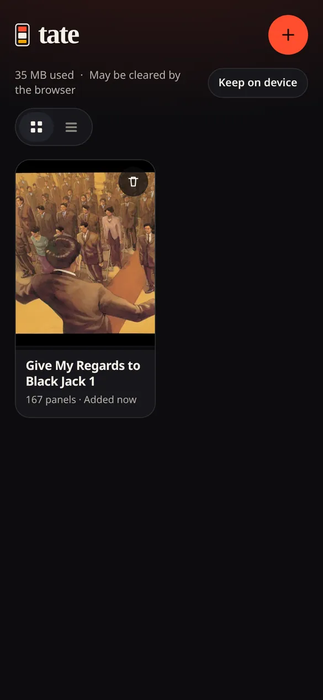
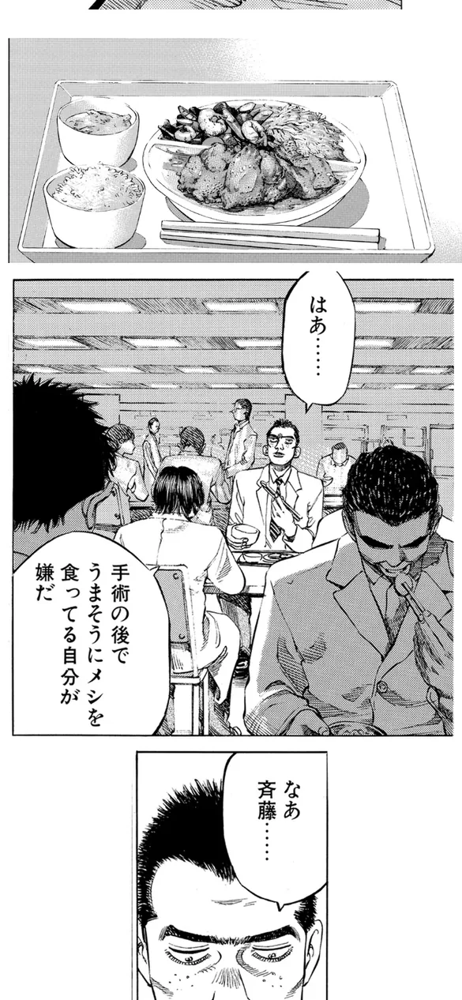

# tate

Read manga the way you read webtoons. tate (縦, "vertical") turns a manga chapter into one vertical strip of panels, in Japanese reading order, sized for a phone screen, and reads it in an installable web app that works offline.

<p align="center">
  
  
  
</p>

<p align="center"><sub>Library · a page as it fits on a phone · the same page in tate</sub></p>

It has two parts:

- **Processor** ([`processor/`](processor/README.md)): a command-line tool for a normal PC, CPU only. It reads a CBZ/ZIP, a PDF, a folder of images, or one image. It detects panels and speech balloons, orders panels right to left and top to bottom, never cuts through a balloon, keeps spreads and wide panels whole, and writes a `.tate` file.
- **Reader** ([`web/`](web/README.md)): a mobile-first web app at <https://heroesofcode.github.io/tate/>. It keeps a library on the device (IndexedDB), works offline once loaded, remembers where you stopped in each chapter, and only keeps nearby panels decoded so long chapters scroll smoothly.

The file shared between them is specified in [docs/format.md](docs/format.md).

## Quick start

### 1. Install the processor

You need [uv](https://docs.astral.sh/uv/) (on Arch-based systems: `sudo pacman -S uv`). Python 3.11 or newer is fetched by uv if needed.

```sh
uv tool install "git+https://github.com/heroesofcode/tate#subdirectory=processor"
```

[pipx](https://pipx.pypa.io/) works with the same URL. To update later, run `uv tool upgrade tate`.

### 2. Process a chapter

```sh
tate process chapter.cbz
tate process volume.pdf --pages 5-40 --title "Chapter 1"
```

This writes `chapter.tate` next to where you run it and prints the number of pages and panels. The first run downloads the panel detector (10 MB) into your user cache. Add `--preview strip.png` to look at the whole strip on the PC first. All options are in [processor/README.md](processor/README.md).

### 3. Read it on your phone

1. Open <https://heroesofcode.github.io/tate/> on the phone.
2. Install it:
   - **Android (Chrome):** tap **Install app** in tate, or browser menu → **Install app** / **Add to Home screen**.
   - **iPhone (Safari):** Share → **Add to Home Screen**.
3. Move the `.tate` file to the phone (USB, LocalSend, a chat app, cloud storage, anything that gives you a file).
4. In tate, tap **+** and pick the file. On Android, once tate is installed, you can also use **Share → tate** from a file manager or chat app.

Chapters stay on the phone and open without a connection. Tap the page to show or hide the controls. Tap **Keep on device** in the library to ask the browser not to clear storage when space runs low.

A plain `.cbz` or `.zip` of page images can also be imported directly. It is shown page by page, without panel splitting.

## Develop

```sh
# processor
cd processor && uv sync && uv run pytest

# reader
cd web && pnpm install && pnpm dev
```

CI runs lint, format, type checks, unit tests and builds for both parts, an end-to-end test that processes a synthetic chapter and reads it in the built app, and a dependency audit. Every push to `main` deploys the reader to GitHub Pages. Details are in each part's README.

## Limitations

- The `cv` fallback detector does not protect speech balloons, so a balloon can be cut where it crosses a panel border. The default `yolo` detector does protect them.
- Panels much narrower than the strip are scaled up at most 1.6× and centered, which leaves white margins.
- A chapter takes about 1 MB per page.
- iOS has no Share → tate entry, so import from the **+** button there.
- No colorization or translation.

## Credits and licenses

tate is released under the [MIT license](LICENSE).

The `yolo` detector downloads third-party weights at runtime. They are not part of this repository: [leoxs22/manga-panel-detector-yolo26n](https://huggingface.co/leoxs22/manga-panel-detector-yolo26n), trained on Manga109-s and licensed **AGPL-3.0**, in the ONNX export by [mednasserallah](https://huggingface.co/mednasserallah/manga-panel-detector-yolo26n-onnx). The `cv` and `page` detectors do not use them. See [processor/README.md](processor/README.md#model-credit-and-licence).

The screenshots show "Give My Regards to Black Jack" (ブラックジャックによろしく) by SHUHO SATO, which the author makes available for free secondary use through [densho810](https://densho810.com/free/). The manga itself is not included in this repository.
